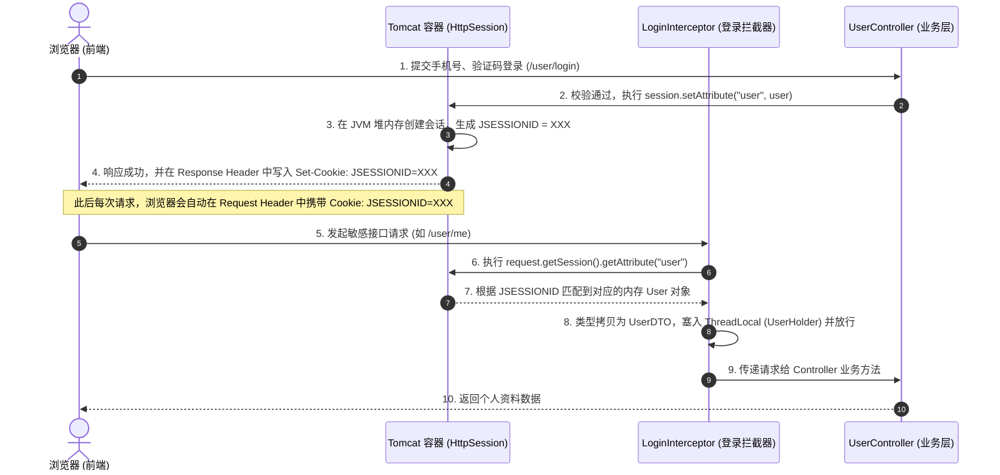

# 传统单机 HttpSession 登录状态管理技术解析

在升级为 Redis + Token 分布式架构之前，系统采用的是基于 **Servlet 规范的原生 `HttpSession` + 浏览器 Cookie 自动携带 `JSESSIONID`** 的传统单机状态管理方案。

以下为该单 Session 鉴权架构的完整流程机制、核心代码剖析以及其在单机开发下的优缺点总结。

---

## 一、 核心流程与运行机制

传统 Session 模式完全依赖浏览器的 **Cookie** 机制来自动传递会话标识。

### 1. 整体运行流程图



### 2. 详细交互流说明

1. **会话创建与绑定**：
   用户成功登录后，后端执行 `session.setAttribute("user", user)`。Tomcat 容器会在底层 JVM 堆内存中自动为该客户端开辟一块有生命周期的 Session 内存，生成唯一随机的 `JSESSIONID`，并自动写入 HTTP 响应的 `Set-Cookie` 头部返回给浏览器。
2. **Cookie 自动携带**：
   浏览器接收到 `JSESSIONID` 的 Cookie 后，会遵循同源策略，在此后向后端发送的**任何 HTTP 请求中自动在 Header 携带**该 Cookie，无需前端编写任何 JS 代码去手动拼接 Header 头部。
3. **前置拦截校验**：
   `LoginInterceptor` 拦截受限接口，通过 `request.getSession()` 获取当前会话。Tomcat 会自动提取请求头里的 `JSESSIONID` 从内存中匹配并取出 `user` 对象。
4. **绑定 ThreadLocal 线程上下文**：
   拦截器为了避免 `ClassCastException`，新建 `UserDTO` 载荷并将 Session 中完整的 `User` 实体对象复制属性拷贝进去，存入 `UserHolder`（基于 ThreadLocal 实现），并在请求完成的 `afterCompletion` 阶段执行 `removeUser()` 销毁 ThreadLocal，防止发生线程池内存泄露。
5. **登出注销**：
   退出登录时，执行 `session.invalidate()`。Tomcat 容器会直接注销并销毁该 JSESSIONID 对应的内存空间。

---

## 二、 核心代码实现剖析

### 1. 登录与 Session 写入（UserServiceImpl.java）
```java
@Override
public Result<String> login(LoginFormDTO loginForm, HttpSession session) {
    String phone = loginForm.getPhone();
    String userInputCode = loginForm.getCode();
    
    // 1. 验证手机号与核验验证码
    boolean verifyPass = aliyunSmsHelper.verifySmsCode(phone, userInputCode);
    if (!verifyPass) {
        throw new BusinessException("验证码核验失败！！！");
    }

    // 2. 根据手机号查询数据库，不存在则自动注册创建用户
    User user = userMapper.getByPhone(phone);
    if (user == null) {
        user = new User();
        user.setPhone(phone);
        user.setNickName("user_" + RandomUtil.randomNumbers(10));
        userMapper.save(user);
    }

    // 3. 将完整的 User 对象直接保存到原生的 HttpSession 容器中
    session.setAttribute("user", user);

    // 4. 单 Session 模式下对前端 Header 无感知，返回占位符即可
    return Result.success("session-token-placeholder");
}
```

### 2. 拦截与绑定上下文（LoginInterceptor.java）
```java
package com.hmdp.interceptor;

import com.hmdp.dto.UserDTO;
import com.hmdp.utils.UserHolder;
import org.springframework.beans.BeanUtils;
import org.springframework.lang.Nullable;
import org.springframework.web.servlet.HandlerInterceptor;

import javax.servlet.http.HttpServletRequest;
import javax.servlet.http.HttpServletResponse;
import javax.servlet.http.HttpSession;

public class LoginInterceptor implements HandlerInterceptor {

    @Override
    public boolean preHandle(HttpServletRequest request, HttpServletResponse response, Object handler) throws Exception {
        // 1. 获取当前请求的 HttpSession
        HttpSession session = request.getSession();
        
        // 2. 获取 session 中存储的 user 属性
        Object user = session.getAttribute("user");
        
        // 3. 判断会话是否存在
        if (user == null) {
            response.setStatus(401); // 未登录，直接拦截
            return false;
        }
        
        // 4. 转换类型为 UserDTO 并绑定到 ThreadLocal，供 Controller/Service 快速获取
        UserDTO userDTO = new UserDTO();
        BeanUtils.copyProperties(user, userDTO);
        UserHolder.saveUser(userDTO);
        
        return true; // 放行
    }

    @Override
    public void afterCompletion(HttpServletRequest request, HttpServletResponse response, Object handler, @Nullable Exception ex) throws Exception {
        // 请求结束后必须手动移除 ThreadLocal 中的变量，防止线程复用导致的内存泄露
        UserHolder.removeUser();
    }
}
```

### 3. 获取状态与退出销毁（UserController.java）
```java
@RestController
@RequestMapping("/user")
@RequiredArgsConstructor
public class UserController {

    private final IUserService userService;

    @PostMapping("/logout")
    public Result logout(HttpSession session) {
        // 销毁当前客户端在 Tomcat 中的会话记录，使其失效
        session.invalidate();
        return Result.success();
    }

    @GetMapping("/me")
    public Result<UserDTO> me() {
        // 直接从当前请求线程的 ThreadLocal 上下文中读取已解析的用户状态并返回
        UserDTO userDTO = UserHolder.getUser();
        if (userDTO == null) {
            return Result.error(ResultCode.UNAUTHORIZED);
        }
        return Result.success(userDTO);
    }
}
```

---

## 三、 传统单机 Session 方案的优缺点深度剖析

### 1. 显著优势
* **对前端零侵入**：浏览器对 Cookie 具备天然的自动化生命周期管理，请求自动携带，前端开发人员无需考虑 Token 的获取、存入 localStorage 或在 axios 请求拦截器中拼接 Header 传输的繁琐步骤。
* **开发开箱即用**：由 Servlet 容器（如 Tomcat）原生在后台托管全部会话管理，无需引入额外的外部 NoSQL 中间件（如 Redis）或分布式缓存。
* **会话过期受 Tomcat 控制**：可在 `application.yaml` 中使用极简的配置 `spring.servlet.session.timeout` 调整 Session 的有效时间，全生命周期管理内置化。

### 2. 致命缺陷（微服务/高并发下的瓶颈）
* **不支持分布式集群扩展**：
  在分布式部署（多台 Tomcat 服务端集群）的情况下，如果用户的登录请求被 Nginx 负载均衡分发到了 A 服务器，A 的 Session 中会有该用户；当用户随后发起下单请求被分发到了 B 服务器时，B 无法获取 A 的内存，将导致用户**被莫名判定为未登录而踢下线**。
* **容易受到 CSRF（跨站请求伪造）攻击**：
  因为 Cookie 在跨域时依然会被浏览器自动携带发送，攻击者可以诱导用户访问钓鱼网站并对您的系统发起伪造请求，直接利用浏览器自动携带的 `JSESSIONID` 绕过认证。
* **Tomcat 内存爆满与性能瓶颈**：
  在高并发、多在线用户场景下，数万名用户的 Session 数据会源源不断地堆积在单台 Tomcat 服务器的 JVM 堆内存中，对内存的占用极其巨大，极易发生 `OutOfMemoryError`（内存溢出）导致服务整体瘫痪挂死。
