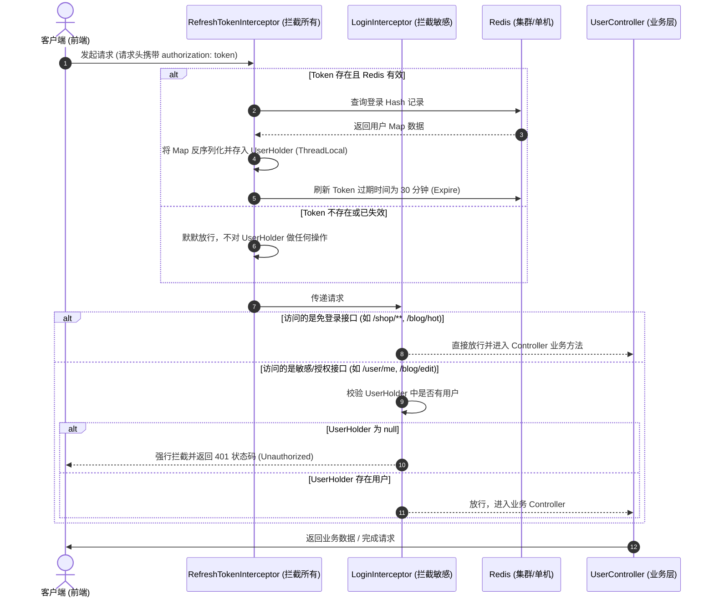

# Redis + Token 分布式登录状态共享技术解析

本项目成功将基于 JVM 内存的单机 `HttpSession` 鉴权升级为了基于 **Redis Hash 存储 + 客户端 Header 携带 Token** 的分布式会话共享架构。

以下为该架构的流程机制、代码剖析及与传统 Session 技术的全方位对比。

---

## 一、 核心流程与运行机制

系统的拦截与登录流设计采用**双拦截器（Double Interceptor）**链式拓扑结构，彻底解决了传统的“只有受限接口才能刷新登录过期时间”的问题。

### 1. 整体运行流程图



### 2. 详细交互流说明

1. **登录（Token 生成与写入）**：
   用户通过手机号和验证码成功登录后，服务端在内存中生成一个随机的 UUID 作为 Token，将脱敏后的 `UserDTO` 转换为 `Map<String, String>`，然后以 **Hash 结构** 存入 Redis，并设置 30 分钟的生存时间（TTL）。随后，服务端把这个 Token 作为成功响应返回给客户端。
2. **前端存储与携带**：
   前端在接收到 Token 后，将其存入 `sessionStorage`，并在后续每次发起 HTTP 请求时，通过 Axios 拦截器自动在 Request Header 中加上 `authorization: <token>` 参数传给后端。
3. **前置拦截（刷新 TTL 与上下文绑定）**：
   `RefreshTokenInterceptor` 拦截所有请求。它拿到 Token 后去 Redis 里查，只要用户在不断操作页面（无论是看商户列表还是发帖），它就会重置该 Key 的过期时间为 30 分钟。随后将用户信息塞入 `UserHolder`。
4. **后置拦截（权限判定）**：
   `LoginInterceptor` 只对非白名单（如个人中心、点赞等）路径进行判定。判定极快，仅需检查 `UserHolder.getUser() != null`。
5. **登出（Token 主动销毁）**：
   用户点击确定登出时，前端调用 `/user/logout`，后端获取其 `authorization` Header，并在 Redis 中将该 Key 直接 `delete` 销毁。

---

### 3. 双拦截器链（Double Interceptor）设计本质与工作原理

在传统的“单拦截器”设计中，通常只对敏感的“登录受限接口”挂载拦截器。这会产生一个致命的体验 Bug：
- 如果用户登录后，连续 30 分钟只在浏览公开的“商铺列表”、“商铺详情”等页面，由于这些接口在白名单中不用拦截，请求**根本不会进入拦截器**。
- 这会导致用户的 Redis Token 过期时间（TTL）一直没有被刷新。
- 30 分钟一到，用户一旦点击“购买/秒杀优惠券”或“发表日记”等授权操作，请求会被突然拦截并退回登录页。**这种在不断操作过程中突然掉线的体验是极差的。**

**双拦截器机制的巧妙解决思路**：
通过把 **“刷新 Token 过期时间”** 与 **“登录状态鉴权拦截”** 这两个职责完全剥离到两个拦截器中：
* **第一层：`RefreshTokenInterceptor` (刷新拦截器，拦截所有请求 `/**`)**：
  - 它像一个前置的过滤网，无差别地贴在所有 API 请求的最前端。
  - 它**一律放行（永远 `return true`）**。哪怕你是一个连 Token 都没有携带的纯游客，它也不会拦截你，而是默默把你交给下一个拦截器。
  - 它的唯一使命是：**“只要你身上带了有效的令牌，我就去 Redis 帮你把保质期延长 30 分钟，并把你的身份塞到当前线程的 ThreadLocal 里。”**
* **第二层：`LoginInterceptor` (登录拦截器，仅拦截敏感接口)**：
  - 它位于第一层拦截器的正下方。因为 `RefreshTokenInterceptor` 的 `order` 设为 `0`，而 `LoginInterceptor` 的 `order` 设为 `1`。
  - 它的职责极其单一：只负责“看门”。它不需要跟 Redis 交互，只需看一眼 `UserHolder.getUser()` 是不是 null。
  - 如果是 null，说明请求既没有带 Token 令牌，也不是一个已经登录过的有效会话，此时由于它配置了拦截名单，会给用户返回 401 错误。
  - 如果不是 null，直接放行，进入业务 Controller。

---

### 4. `RefreshTokenInterceptor` 检查并处理 Token 的底层机制

在这个拦截器内部，检查并处理 Token 的核心机制和原理如下：

```java
// 1. 从请求头获取 token
String token = request.getHeader("authorization");
```
* **原理解析**：前端在发起请求时，会自动在 Request Header 的 `authorization` 字段中带上登录令牌 Token。

```java
if (StrUtil.isBlank(token)) {
    return true; // 游客状态，无 token，直接放行给后续拦截器
}
```
* **原理解析**：如果 Header 是空的，说明当前是个未登录的普通访客。拦截器不做任何额外处理，直接放行。此时 `UserHolder` 依然为空。

```java
// 2. 基于 token 获取 Redis 中的用户 Map
String key = RedisConstants.LOGIN_USER_KEY + token;
Map<Object, Object> userMap = stringRedisTemplate.opsForHash().entries(key);
```
* **原理解析**：如果带了 Token，则拼装出 Redis 中的 Key。我们使用 `opsForHash().entries(key)` 去 Redis 中查询该 Token 对应的 Hash 结构实体。如果 Token 已经过期，或者是一个伪造的假 Token，Redis 会返回一个空的 Map。

```java
// 3. 判断用户是否存在
if (userMap.isEmpty()) {
    return true; // token 已失效或伪造，放行
}
```
* **原理解析**：如果 Map 为空，说明 Token 无效。拦截器不报错，直接放行。因为 `UserHolder` 依然是空的，稍后如果该请求访问的是敏感接口，会被后置的 `LoginInterceptor` 拦截。

```java
// 4. 将查询到的 Hash 数据还原为 UserDTO 实体并存入 ThreadLocal
UserDTO userDTO = BeanUtil.fillBeanWithMap(userMap, new UserDTO(), false);
UserHolder.saveUser(userDTO);
```
* **原理解析**：如果 Map 不为空，证明 Token 真实有效。利用 Hutool 的工具将 Map 快速反序列化还原为 `UserDTO`，并塞入当前线程绑定的 ThreadLocal 变量中。这使得在当前请求后续执行的所有 Controller 和 Service 都可以通过 `UserHolder.getUser()` 直接共享读取用户信息。

```java
// 5. 刷新 token 有效期
stringRedisTemplate.expire(key, RedisConstants.LOGIN_USER_TTL, TimeUnit.SECONDS);
```
* **原理解析**：重置 Redis 中该 Key 的生存期限，令其重新进入 30 分钟倒计时，实现用户的**操作无感自动续期**。

   用户点击确定登出时，前端调用 `/user/logout`，后端获取其 `authorization` Header，并在 Redis 中将该 Key 直接 `delete` 销毁。

---

## 二、 关键代码实现剖析

### 1. 全局请求头刷新拦截器（RefreshTokenInterceptor.java）
负责在最前端提取 Token、反序列化 Map 并注入 `UserHolder` 上下文，同时重置 TTL。无论是否成功登录，一律放行。
```java
package com.hmdp.interceptor;

import cn.hutool.core.bean.BeanUtil;
import cn.hutool.core.util.StrUtil;
import com.hmdp.constant.RedisConstants;
import com.hmdp.dto.UserDTO;
import com.hmdp.utils.UserHolder;
import org.springframework.data.redis.core.StringRedisTemplate;
import org.springframework.web.servlet.HandlerInterceptor;

import javax.servlet.http.HttpServletRequest;
import javax.servlet.http.HttpServletResponse;
import java.util.Map;
import java.util.concurrent.TimeUnit;

public class RefreshTokenInterceptor implements HandlerInterceptor {

    private final StringRedisTemplate stringRedisTemplate;

    public RefreshTokenInterceptor(StringRedisTemplate stringRedisTemplate) {
        this.stringRedisTemplate = stringRedisTemplate;
    }

    @Override
    public boolean preHandle(HttpServletRequest request, HttpServletResponse response, Object handler) throws Exception {
        // 1. 获取请求头中的 token
        String token = request.getHeader("authorization");
        if (StrUtil.isBlank(token)) {
            return true; // 游客状态，无 token，直接放行给后续拦截器
        }

        // 2. 基于 token 获取 Redis 中的用户 Map
        String key = RedisConstants.LOGIN_USER_KEY + token;
        Map<Object, Object> userMap = stringRedisTemplate.opsForHash().entries(key);

        // 3. 判断用户是否存在
        if (userMap.isEmpty()) {
            return true; // token 已失效或伪造，直接放行
        }

        // 4. 将查询到的 Hash 数据转回 UserDTO 对象
        UserDTO userDTO = BeanUtil.fillBeanWithMap(userMap, new UserDTO(), false);

        // 5. 存在，保存用户信息到 UserHolder 线程上下文中
        UserHolder.saveUser(userDTO);

        // 6. 刷新 token 有效期
        stringRedisTemplate.expire(key, RedisConstants.LOGIN_USER_TTL, TimeUnit.SECONDS);

        // 7. 放行
        return true;
    }

    @Override
    public void afterCompletion(HttpServletRequest request, HttpServletResponse response, Object handler, Exception ex) throws Exception {
        UserHolder.removeUser();
    }
}
```


`afterCompletion` 是 Spring MVC 拦截器的**收尾回调**——在整个请求处理完毕、响应已经返回给客户端**之后**执行，用来做清理工作。

Spring 拦截器的三个生命周期

```
请求到达
  │
  ▼
preHandle()  ──── 返回 false → 请求被拦截，到此为止
  │  返回 true
  ▼
Controller 方法执行 (你的业务逻辑)
  │
  ▼
afterCompletion() ──── 视图渲染完成，响应已发给客户端，做善后清理
```

**在这个项目中的具体执行流程**

以一次 `/user/me` 请求为例：

```
1. preHandle()
   ├── 从请求头取 token
   ├── 查 Redis 拿到 UserDTO
   └── UserHolder.saveUser(userDTO)    ← 把用户"绑"到当前线程
   
2. Controller.me() 执行
   ├── UserHolder.getUser()            ← Controller 里直接用
   └── 返回 ResponseEntity (200 OK)
   
3. afterCompletion()                   ← 响应已经发出去了
   └── UserHolder.removeUser()         ← 把 ThreadLocal 清掉
```

**为什么必须 `removeUser()**

核心原因：**Tomcat 使用线程池**，线程是复用的。

```
请求A:  线程1 处理 → ThreadLocal 里存了用户"张三" → 请求结束，线程1归还池
                                                      │
                                                      ▼ 没 remove 的话：
请求B:  线程1 被复用 → ThreadLocal 里还残留着"张三" → 请求B拿到的用户是错的！
```

如果不清空，就可能发生**用户信息串号**——下一个请求复用同一个线程时，会读到上一个请求遗留的用户数据，这是严重的安全漏洞。


### 2. 核心鉴权拦截器（LoginInterceptor.java）

职责极其单一，仅需要判断 `UserHolder` 是否为 null 即可：
```java
package com.hmdp.interceptor;

import com.hmdp.utils.UserHolder;
import org.springframework.web.servlet.HandlerInterceptor;

import javax.servlet.http.HttpServletRequest;
import javax.servlet.http.HttpServletResponse;

public class LoginInterceptor implements HandlerInterceptor {

    @Override
    public boolean preHandle(HttpServletRequest request, HttpServletResponse response, Object handler)  {
        // 只需要判断 UserHolder 中是否有用户（由前面的 RefreshTokenInterceptor 写入）
        if (UserHolder.getUser() == null) {
            response.setStatus(401);
            return false;
        }
        return true;
    }
}
```

### 3. MVC 配置类（MvcConfig.java）
注册双拦截器并配置不同的优先级（`order`），传入 RedisTemplate：
```java
package com.hmdp.config;

import com.hmdp.interceptor.LoginInterceptor;
import com.hmdp.interceptor.RefreshTokenInterceptor;
import lombok.RequiredArgsConstructor;
import org.springframework.context.annotation.Configuration;
import org.springframework.data.redis.core.StringRedisTemplate;
import org.springframework.web.servlet.config.annotation.InterceptorRegistry;
import org.springframework.web.servlet.config.annotation.WebMvcConfigurer;

@Configuration
@RequiredArgsConstructor
public class MvcConfig implements WebMvcConfigurer {

    private final StringRedisTemplate stringRedisTemplate;

    @Override
    public void addInterceptors(InterceptorRegistry registry) {
        // 1. token 刷新拦截器 (拦截所有请求，order = 0 最优先执行)
        registry.addInterceptor(new RefreshTokenInterceptor(stringRedisTemplate))
                .addPathPatterns("/**")
                .order(0);

        // 2. 登录验证拦截器 (拦截敏感路径，order = 1 随后执行)
        registry.addInterceptor(new LoginInterceptor())
                .excludePathPatterns(
                        "/shop/**",
                        "/voucher/**",
                        "/shop-type/**",
                        "/upload/**",
                        "/blog/hot",
                        "/user/code",
                        "/user/login"
                ).order(1);
    }
}
```

### 4. 登录业务逻辑（UserServiceImpl.java）
生成 UUID 作为 Token，序列化 `UserDTO` 并写入 Redis Hash，设置 30 分钟生命周期：
```java
package com.hmdp.service.impl;

import cn.hutool.core.bean.BeanUtil;
import cn.hutool.core.bean.copier.CopyOptions;
import cn.hutool.core.lang.UUID;
import cn.hutool.core.util.RandomUtil;
import com.hmdp.constant.RedisConstants;
import com.hmdp.dto.LoginFormDTO;
import com.hmdp.dto.Result;
import com.hmdp.dto.UserDTO;
import com.hmdp.entity.User;
import com.hmdp.exception.BusinessException;
import com.hmdp.mapper.UserMapper;
import com.hmdp.service.IUserService;
import com.hmdp.utils.AliyunSmsHelper;
import com.hmdp.utils.RegexUtils;
import lombok.RequiredArgsConstructor;
import lombok.extern.slf4j.Slf4j;
import org.springframework.data.redis.core.StringRedisTemplate;
import org.springframework.stereotype.Service;

import javax.servlet.http.HttpSession;
import java.util.HashMap;
import java.util.Map;
import java.util.concurrent.TimeUnit;

@Service
@Slf4j
@RequiredArgsConstructor
public class UserServiceImpl implements IUserService {

    private final UserMapper userMapper;
    private final AliyunSmsHelper aliyunSmsHelper;
    private final StringRedisTemplate stringRedisTemplate;

    @Override
    public User getById(Long id) {
        return userMapper.getById(id);
    }

    @Override
    public Result<String> sendCode(String phone, HttpSession session) {
        if (RegexUtils.isPhoneInvalid(phone)) {
            throw new BusinessException("手机号格式错误！！！");
        }
        
        // 调用封装好的阿里云短信助手发送验证码
        aliyunSmsHelper.sendSmsCode(phone);
        
        return Result.success();
    }

    @Override
    public Result<String> login(LoginFormDTO loginForm, HttpSession session) {
        String phone = loginForm.getPhone();
        String userInputCode = loginForm.getCode();
        if (RegexUtils.isPhoneInvalid(phone)) {
            throw new BusinessException("手机号格式错误！！！");
        }

        // 调用封装好的阿里云短信助手核验验证码
        boolean verifyPass = aliyunSmsHelper.verifySmsCode(phone, userInputCode);
        if (!verifyPass) {
            throw new BusinessException("验证码核验失败！！！");
        }

        User user = userMapper.getByPhone(phone);
        if (user == null) {
            user = new User();
            user.setPhone(phone);
            user.setNickName("user_" + RandomUtil.randomNumbers(10));
            userMapper.save(user);
        }

        // 1. 随机生成 token，作为登录令牌
        String token = UUID.randomUUID().toString(true);

        // 2. 将 User 转换为 UserDTO
        UserDTO userDTO = BeanUtil.copyProperties(user, UserDTO.class);

        // 3. 将 UserDTO 对象转为 Map，并确保所有字段的值均为 String 类型，防止 Redis Hash 存入报错
        Map<String, Object> userMap = BeanUtil.beanToMap(userDTO, new HashMap<>(),
                CopyOptions.create()
                        .setIgnoreNullValue(true)
                        .setFieldValueEditor((fieldName, fieldValue) -> fieldValue == null ? "" : fieldValue.toString()));

        // 4. 以 Hash 结构存储用户数据到 Redis
        String tokenKey = RedisConstants.LOGIN_USER_KEY + token;
        stringRedisTemplate.opsForHash().putAll(tokenKey, userMap);

        // 5. 设置 token 的有效期（30分钟）
        stringRedisTemplate.expire(tokenKey, RedisConstants.LOGIN_USER_TTL, TimeUnit.SECONDS);

        // 6. 返回 token 给前端
        return Result.success(token);
    }
}
```

### 5. 控制层接口交互（UserController.java）
从 Header 获取 Token 主动 delete 登出，从 UserHolder 统一取用户状态：
```java
package com.hmdp.controller;

import cn.hutool.core.util.StrUtil;
import com.hmdp.constant.RedisConstants;
import com.hmdp.dto.LoginFormDTO;
import com.hmdp.dto.Result;
import com.hmdp.dto.ResultCode;
import com.hmdp.dto.UserDTO;
import com.hmdp.utils.UserHolder;
import com.hmdp.entity.UserInfo;
import com.hmdp.service.IUserInfoService;
import com.hmdp.service.IUserService;
import lombok.RequiredArgsConstructor;
import lombok.extern.slf4j.Slf4j;
import org.springframework.data.redis.core.StringRedisTemplate;
import org.springframework.web.bind.annotation.*;

import javax.servlet.http.HttpServletRequest;
import javax.servlet.http.HttpSession;

@Slf4j
@RestController
@RequiredArgsConstructor
@RequestMapping("/user")
public class UserController {

    private final IUserService userService;
    private final IUserInfoService userInfoService;
    private final StringRedisTemplate stringRedisTemplate;

    /**
     * 发送手机验证码
     */
    @PostMapping("code")
    public Result<String> sendCode(@RequestParam("phone") String phone, HttpSession session) {
        return userService.sendCode(phone, session);
    }

    /**
     * 登录功能
     */
    @PostMapping("/login")
    public Result<String> login(@RequestBody LoginFormDTO loginForm, HttpSession session){
        return userService.login(loginForm, session);
    }

    /**
     * 登出功能
     */
    @PostMapping("/logout")
    public Result logout(HttpServletRequest request){
        // 从请求头获取 token
        String token = request.getHeader("authorization");
        if (StrUtil.isNotBlank(token)) {
            // 从 Redis 中删除 Token
            stringRedisTemplate.delete(RedisConstants.LOGIN_USER_KEY + token);
        }
        return Result.success();
    }

    @GetMapping("/me")
    public Result<UserDTO> me(){
        // 直接从当前线程的 UserHolder 中获取由拦截器解析出的用户信息并返回
        UserDTO userDTO = UserHolder.getUser();
        if (userDTO == null) {
            return Result.error(ResultCode.UNAUTHORIZED);
        }
        return Result.success(userDTO);
    }

    @GetMapping("/info/{id}")
    public Result<UserInfo> info(@PathVariable("id") Long userId){
        // 查询详情
        UserInfo info = userInfoService.getById(userId);
        if (info == null) {
            // 没有详情，应该是第一次查看详情
            return Result.success();
        }
        info.setCreateTime(null);
        info.setUpdateTime(null);
        // 返回
        return Result.success(info);
    }
}
```

### 6.UserHolder

```java
public class UserHolder {
    private static final ThreadLocal<UserDTO> tl = new ThreadLocal<>();

    public static void saveUser(UserDTO user){
        tl.set(user);
    }

    public static UserDTO getUser(){
        return tl.get();
    }

    public static void removeUser(){
        tl.remove();
    }
}
```

