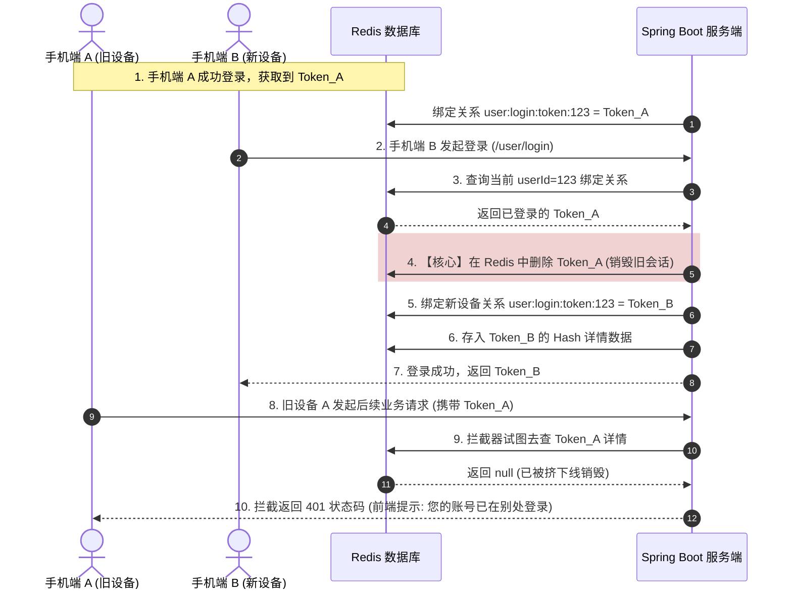

# Redis + Token 方案下的强制下线与单设备限制实现指南

基于自研的 Redis + Token 登录鉴权方案，由于数据集中存储在 Redis 中，使得我们能够轻松在服务端实现**强制下线（踢人）**以及**单设备登录限制（同账号挤掉前一次登录）**。

以下为两种控制方案的详细实现原理、流向图及后端核心伪代码设计。

---

## 一、 强制下线（Force Logout / Kick Out）的实现

强制下线的本质是**销毁客户端持有的 Token 在 Redis 中的映射记录**。

### 1. 实现机制与步骤

* **单设备强制下线（针对某次特定会话）**：
  如果用户在个人中心查看“我的登录设备列表”，可以点击“下线该设备”。
  * **后端处理**：直接根据传入的 `Token`，在 Redis 中将对应的 Key 删除：
    ```java
    stringRedisTemplate.delete("login:token:" + targetToken);
    ```
  * **拦截表现**：该设备下一次发起请求时，前置拦截器去 Redis 查询会直接返回空 Map，导致 ThreadLocal 中没有用户，后置拦截器无情拦截并返回 `401` 强制其退回登录页。

* **全端强制下线（将该用户的所有在线设备全部踢下线，如修改密码后）**：
  如果只保留 `login:token:TokenUUID` 结构，我们无法在 O(1) 复杂度内根据 `userId` 找出该用户的所有随机 Token。
  * **方案设计**：登录时，在 Redis 中额外维护一个以 **`Set` 结构** 保存的“用户与 Token 关系列表”：
    * Key 结构：`user:login:tokens:userId`
    * Value 结构：`Set<Token>` （存放该用户当前所有在线的随机 Token 令牌）。
  * **全端踢人代码蓝图**：
    ```java
    public void kickOutUserAllDevices(Long userId) {
        String relationKey = "user:login:tokens:" + userId;
        // 1. 获取该用户所有在线设备的 Token 列表
        Set<String> tokens = stringRedisTemplate.opsForSet().members(relationKey);
        if (CollUtil.isNotEmpty(tokens)) {
            // 2. 批量拼接出要删除的 login:token:xxx 的 Key
            List<String> tokenKeys = tokens.stream()
                .map(t -> "login:token:" + t)
                .collect(Collectors.toList());
            // 3. 批量删除 Redis 中的 Token 数据
            stringRedisTemplate.delete(tokenKeys);
        }
        // 4. 删除关系记录 Key
        stringRedisTemplate.delete(relationKey);
    }
    ```

---

## 二、 单设备登录限制（Single Device Limit / 挤下线）

### 1. 业务流程图




当前项目使用 Redis + Token 的机制。默认情况下，用户每次登录都会生成一个全新的 UUID Token，并以 `login:token:{token}` 的形式存入 Redis。由于不同设备的 Token 不一样，它们在 Redis 中互不干扰，因此就造成了“多设备可以同时在线”的现象。

要实现“同一时间只允许一台设备登录（单点登录/踢人下线）”，核心思想是：**建立【用户】到【Token】的绑定关系，在新登录时销毁旧 Token。**

核心实现步骤:

1. **建立双向绑定映射:**

除了保留现有的 `Token -> 用户信息` 的映射外，还需要在 Redis 中新增一个映射，记录 `用户 ID -> 当前有效 Token`。
- **现有结构**：`login:token:{token}` -> `UserDTO`
- **新增结构**：`login:user:{userId}` -> `{token}`

2. **改造登录接口（UserServiceImpl.login）**：

当用户（假设 ID 为 `1001`）登录验证成功，准备签发新 Token 时，执行以下逻辑：
1. **检查旧 Token**：去 Redis 中查询 `login:user:1001` 是否存在。
2. **踢出旧设备**：如果存在旧的 Token，说明该账号在别处登录过。我们直接用 Redis 删除那个旧 Token 所对应的 `login:token:{old_token}` 键。
3. **签发新 Token**：生成全新的 Token，像往常一样存入 `login:token:{new_token}`。
4. **更新绑定关系**：将 `login:user:1001` 的值更新为当前的新 `{new_token}`。

3. **被踢出的设备表现：**

由于旧设备的 Token 对应的 Redis 键已经被我们强制删除了。当旧设备再次发起请求（比如点击个人中心、或者刷新页面）时，后端的 `LoginInterceptor` 拦截器拿着旧 Token 去 Redis 里一查，发现查不到数据了，就会返回 `401 Unauthorized`。前端拿到 401 就会自动跳回登录页，从而完美实现了“被踢下线”的效果。


### 2. 核心代码实现

在 `login` 业务逻辑方法中执行以下逻辑：

```java
@Override
public Result<String> login(LoginFormDTO loginForm, HttpSession session) {
    
    
        // 1. 生成新 token 之前，先检查该用户是否已有登录的 token，实现“踢人下线”
        String userTokenKey = "login:user:" + user.getId();
        String oldToken = stringRedisTemplate.opsForValue().get(userTokenKey);
        if (cn.hutool.core.util.StrUtil.isNotBlank(oldToken)) {
            // 如果存在旧 token，则将其删除
            stringRedisTemplate.delete(RedisConstants.LOGIN_USER_KEY + oldToken);
        }

        // 2. 随机生成 token，作为登录令牌
        String token = UUID.randomUUID().toString(true);
        log.info("token:{}", token);

        // 3. 将 User 转换为 UserDTO
        UserDTO userDTO = BeanUtil.copyProperties(user, UserDTO.class);

        // 4. 将 UserDTO 对象转为 Map
        Map<String, Object> userMap = BeanUtil.beanToMap(userDTO, new HashMap<>(),
                CopyOptions.create()
                        .setIgnoreNullValue(true)
                        .setFieldValueEditor((fieldName, fieldValue) -> fieldValue == null ? "" : fieldValue.toString()));
        
        // 5. 以 Hash 结构存储用户数据到 Redis
        String tokenKey = RedisConstants.LOGIN_USER_KEY + token;
        stringRedisTemplate.opsForHash().putAll(tokenKey, userMap);
        // 设置 token 的有效期（30分钟）
        stringRedisTemplate.expire(tokenKey, RedisConstants.LOGIN_USER_TTL, TimeUnit.SECONDS);

        // 6. 记录 当前用户ID -> 最新Token 的映射，并保持同样的有效期
        stringRedisTemplate.opsForValue().set(userTokenKey, token, RedisConstants.LOGIN_USER_TTL, TimeUnit.SECONDS);

        // 7. 返回 token 给前端
        return Result.success(token);
}
```

更新拦截器代码：

```java
// 6. 刷新 token 有效期
stringRedisTemplate.expire(key, RedisConstants.LOGIN_USER_TTL, TimeUnit.SECONDS);

// 同时刷新 login:user:{userId} 的有效期，避免单设备登录映射失效
String userTokenKey = "login:user:" + userDTO.getId();
stringRedisTemplate.expire(userTokenKey, RedisConstants.LOGIN_USER_TTL, TimeUnit.SECONDS);

```


### 3. 前端配合与友好提示

当旧设备的旧 Token 被删除后，它的下一次请求在 `request.js` 全局响应拦截器中会收到 `401`。
前端可以在响应拦截器中做如下处理：

```javascript
// axios 响应拦截器
request.interceptors.response.use(
  response => response.data,
  error => {
    if (error.response && error.response.status === 401) {
      // 1. 清除本地 Token 缓存
      sessionStorage.removeItem('token');
      // 2. 弹窗友情提示用户
      ElMessageBox.alert('您的账号已在另一台设备登录，您已被迫下线！', '下线通知', {
        confirmButtonText: '确定',
        callback: () => {
          // 3. 跳转回系统主页或登录页
          router.replace('/');
        }
      });
    }
    return Promise.reject(error);
  }
);
```
